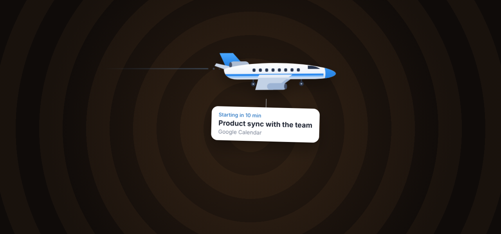
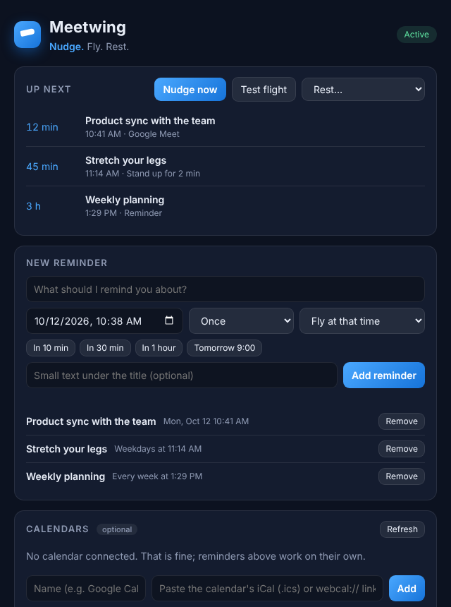
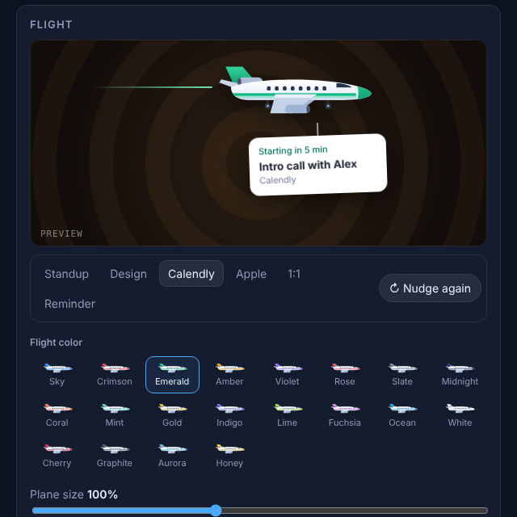
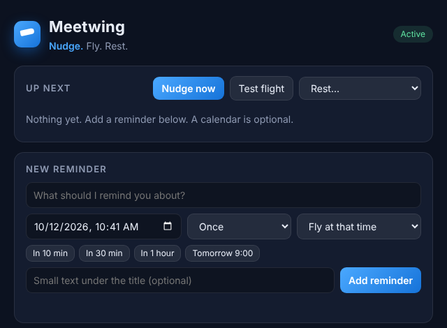
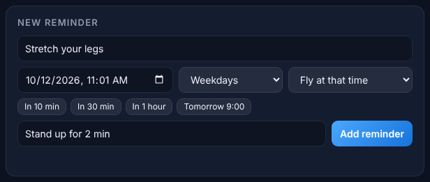
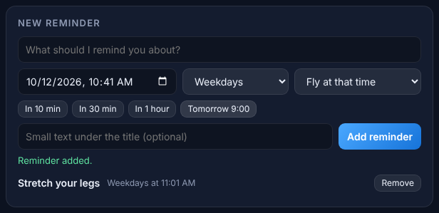
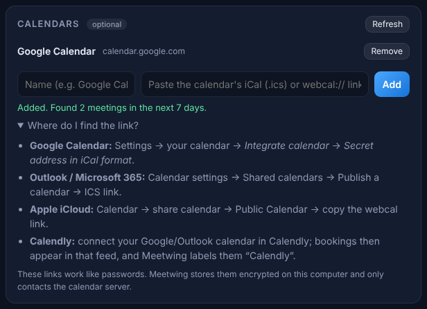
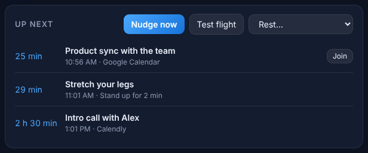
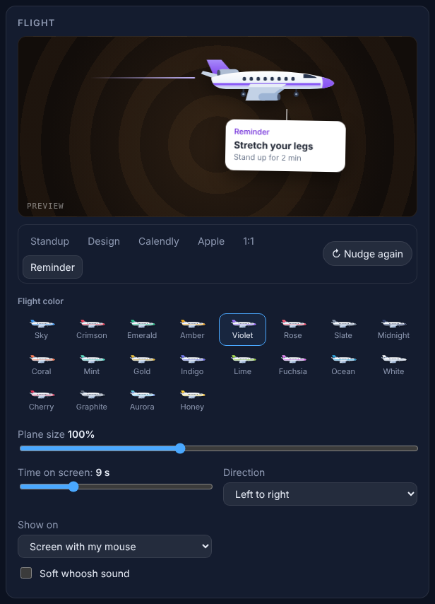

<p align="center">
  
</p>

<h1 align="center">Meetwing</h1>

<p align="center"><b>Nudge. Fly. Rest.</b><br />
A desktop reminder app for Windows, macOS and Ubuntu. Before every meeting or reminder, a small jet
flies across your screen towing a card with what is next.</p>

<p align="center">
  <a href="#how-to-use-meetwing">How to use</a> &middot;
  <a href="#install">Install</a> &middot;
  <a href="https://shipwithajay.com/products/meetwing#demo">Demo</a> &middot;
  <a href="docs/index.html">Landing page</a> &middot;
  <a href="#built-by">Built by</a>
</p>



It lives in your menu bar / system tray, never steals focus or clicks, and needs no account.

| Reminders and what is up next | Flight preview, 20 colors and size |
| --- | --- |
|  |  |

## How to use Meetwing

A quick walkthrough with screenshots from the app. The names and times in them are example data.

### 1. Open Meetwing

After installing (see [Install](#install)), start Meetwing. The settings window opens by itself the
first time. After that Meetwing lives in your menu bar (macOS) or system tray (Windows, Ubuntu):
click its icon and choose **Settings…** to come back here.



### 2. Add a reminder

Type what you want to be reminded about, pick a time (or tap **In 10 min**, **In 30 min**,
**In 1 hour**, **Tomorrow 9:00**), and choose whether it repeats: once, every day, weekdays or
every week. The small text is optional and appears under the title on the card.



### 3. Save it

Press **Add reminder**. It appears in the list, where **Remove** deletes it. No calendar or account
is needed for this.



### 4. Watch the jet fly

When it is time, a jet flies across the screen your mouse is on, towing a card with the reminder.
It never takes your clicks or keyboard, so you can keep working while it passes.


### 5. Connect a calendar (optional)

To get reminders for meetings automatically, paste your calendar's iCal link under **Calendars**.
**Where do I find the link?** shows where to copy it for Google Calendar, Outlook, iCloud and Calendly.
Meetwing then flies 10 and 5 minutes before each meeting (you can change these times).



### 6. See what is next, join, or rest

**Up next** lists your next reminders and meetings. **Join** opens the meeting's Zoom, Meet or Teams
link. **Nudge now** flies the next reminder right away, **Test flight** shows a sample flight, and
**Rest** pauses the jet for an hour, until tomorrow, or until you resume.



Shortcuts that work from anywhere: <kbd>Ctrl/Cmd</kbd>+<kbd>Shift</kbd>+<kbd>N</kbd> to nudge,
<kbd>Ctrl/Cmd</kbd>+<kbd>Shift</kbd>+<kbd>J</kbd> to join the next call.

### 7. Make it yours

Under **Flight**, pick one of 20 jet colors and the plane size, and watch the live preview. Choose a
scene and press **Nudge again** to replay it. You can also set how long it stays on screen, the
direction it flies, which screen it uses, and an optional soft whoosh sound.



## Features

- **Flying reminders** - the jet glides in, hovers so you can read the card, and leaves. Pick how
  long it stays, how big it is, which direction it flies, and which screen it appears on.
- **20 flight colors + live preview** - Sky, Crimson, Emerald, Amber, Violet, Rose, Slate,
  Midnight, Coral, Mint, Gold, Indigo, Lime, Fuchsia, Ocean, White, Cherry, Graphite, Aurora and
  Honey. Settings shows a live preview with example scenes (Standup, Design, Calendly, Apple, 1:1,
  Reminder) and a *Nudge again* button; *Test flight* flies the selected scene for real.
- **Simple reminders, no calendar needed** - type what to remember, pick a time, and optionally
  repeat it every day, on weekdays or weekly. The jet flies at that time (or ahead of it, like a
  meeting). A calendar link is never required.
- **Your calendars (optional)** - add any iCalendar (`.ics` / `webcal://`) feed: Google Calendar, Outlook /
  Microsoft 365, iCloud, Fastmail, Proton, ... Recurring events, time zones, exceptions and
  cancellations are handled. Meetings booked through **Calendly** (or Cal.com) are labelled as such.
- **Reminder times** - default 10 and 5 minutes before; use any list you like, plus optionally
  "when it starts".
- **Nudge** (`Ctrl/Cmd+Shift+N`) - fly the next meeting's reminder right now.
- **Join** (`Ctrl/Cmd+Shift+J`) - open the next meeting's Zoom / Meet / Teams / Webex link.
- **Rest** - pause reminders for an hour, until tomorrow, or until you resume. Reminders that come
  due while resting are skipped, not replayed afterwards.
- **Private** - calendar links work like passwords, so they are stored encrypted with your OS
  keychain (Electron `safeStorage`). The app only talks to your calendar servers.
- Optional soft whoosh sound and start-at-login.

## Adding a calendar (optional)

You only need this to get reminders for meetings that already live in a calendar. Open **Settings** (tray icon -> *Settings...*, or it opens on first run) and paste the feed link:

| Calendar | Where to find the link |
| --- | --- |
| Google Calendar | Settings -> your calendar -> *Integrate calendar* -> **Secret address in iCal format** |
| Outlook / Microsoft 365 | Calendar settings -> Shared calendars -> Publish a calendar -> **ICS link** |
| Apple iCloud | Share the calendar as a *Public Calendar* and copy the `webcal://` link |
| Calendly | Connect your Google/Outlook calendar in Calendly; bookings appear in that feed |

Skip this section entirely if you only want simple reminders. Meetwing does not use OAuth, so there is no sign-in and no account: just a read-only link.

<a id="install"></a>

## Run from source

Requires Node.js 20+.

```bash
npm install
npm start          # add --settings to force the settings window open
npm test
```

**Linux:** if Electron aborts with `The SUID sandbox helper binary was found, but is not configured
correctly`, `npm start` already falls back to `--no-sandbox` for development. To keep the sandbox on,
run `sudo chown root:root node_modules/electron/dist/chrome-sandbox && sudo chmod 4755 node_modules/electron/dist/chrome-sandbox`.
The `.deb` package configures this for you. On Ubuntu 23.10+/24.04 the AppImage may need
`--no-sandbox` because of AppArmor's unprivileged-userns restriction; prefer the `.deb`.

GNOME needs the *AppIndicator* extension to show tray icons. Without a tray, launching Meetwing
again opens the settings window.

## Build installers

Build on the OS you are targeting:

| Platform | Command | Output in `dist/` |
| --- | --- | --- |
| Ubuntu / Linux | `npm run dist:linux` | `.AppImage`, `.deb` |
| macOS | `npm run dist:mac` | `.dmg`, `.zip` (x64 + arm64) |
| Windows | `npm run dist:win` | NSIS installer `.exe`, portable `.exe` |

Install the `.deb` with `sudo apt install ./dist/Meetwing-*-linux-amd64.deb`.

### CI

`.github/workflows/build.yml` runs the tests, then builds all three platforms and uploads the
installers as workflow artifacts. Pushing a tag like `v0.1.0` attaches them to a GitHub Release.
Builds are **unsigned**: macOS shows a Gatekeeper warning (right-click -> Open) and Windows
SmartScreen may warn until you add signing certificates (`CSC_LINK`, `CSC_KEY_PASSWORD`, `APPLE_*`).

## How it works

```
src/main/       main process: tray, flights, scheduler wiring, settings IPC
  ics.js          ICS parsing + recurrence expansion (ical.js)
  calendar.js     feed fetching, merging and de-duplication
  settings.js     settings store; calendar links encrypted
src/shared/     scheduler.js: which reminders are due (pure, unit tested)
src/renderer/   overlay.* (the jet animation) and settings.* (the settings window)
src/preload/    minimal contextBridge APIs, one per window
test/           node:test unit tests (npm test)
scripts/        make-icon.js generates build/icon.png; start.js is the dev launcher
```

Each flight is a transparent, click-through, always-on-top window covering one display. It is
created for the flight and destroyed afterwards, so nothing sits on your screen the rest of the day.
Calendars refresh every 5 minutes and after waking from sleep; the scheduler checks every 15 seconds.

<a id="built-by"></a>

## Built by


**Jai Sudhakar** · Full-stack eCommerce developer, 8+ years<br />
Shopify Partner building themes and apps, with Magento 2, PHP and Node. Now building Shopify apps
and AI developer tools, including Meetwing.<br />
Native Brand Technologies · Coimbatore, India<br />
[onemandeveloper.com](https://onemandeveloper.com) · [GitHub @jaisudhakar](https://github.com/jaisudhakar)

<br clear="left" />
